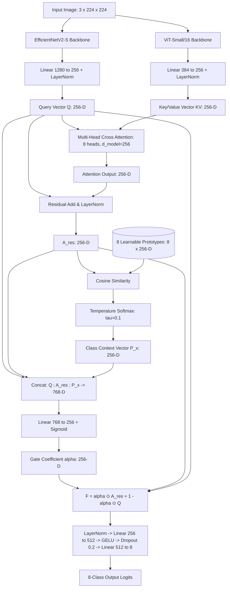

# Trustworthy-Capsule-AI

> **Hybrid CNN–ViT framework for 8-class capsule endoscopy analysis using cross-attention, class-aware prototype-guided fusion, and explainability techniques.**

---

## Table of Contents
- [Overview](#overview)
- [Research Motivation](#research-motivation)
- [Dataset](#dataset)
- [Model Architecture](#model-architecture)
  - [Architecture Flow](#architecture-flow)
  - [Mathematical Formulation](#mathematical-formulation)
  - [Adaptive vs. Class-Aware Gating](#adaptive-vs-class-aware-gating)
- [Model Variants](#model-variants)
- [Training Configuration](#training-configuration)
- [Explainability & Trustworthiness](#explainability--trustworthiness)
- [Project Structure](#project-structure)
- [Installation](#installation)
- [Dataset Setup](#dataset-setup)
- [Inference & Usage](#inference--usage)
- [Evaluation & Benchmarking](#evaluation--benchmarking)
- [Training (Optional)](#training-optional)
- [Experimental Results](#experimental-results)
- [Limitations](#limitations)
- [License](#license)
- [Citation](#citation)

---

## Overview

**Trustworthy-Capsule-AI** is a deep learning framework developed for **8-class capsule endoscopy finding/anatomical/visibility classification**. Wireless capsule endoscopy (WCE) captures thousands of video frames during gastrointestinal transit, presenting substantial diagnostic complexity due to variable illumination, motion blur, and subtle mucosal variations.

The framework integrates:
- **Convolutional Neural Networks (EfficientNetV2-S)** to capture localized structural and textural features.
- **Vision Transformers (ViT-Small/16)** to capture long-range contextual dependencies across the image.
- **Cross-Attention Fusion** to align and exchange multi-modal feature representations between the backbones.
- **Class-Aware Prototype Guidance** to condition the feature gating mechanism on dynamic class similarity representations.
- **Trustworthiness & Explainability Modules** including Grad-CAM visual explanations, Monte Carlo Dropout uncertainty estimation, Expected Calibration Error (ECE) analysis, and quantitative perturbation-based faithfulness evaluations.

> **Note on Terminology**: The target classification task comprises an **8-class finding/anatomical/visibility taxonomy** (pathological findings, normal anatomical landmarks, and visibility quality indicators). It is not solely a disease detection system.

---

## Research Motivation

Capsule endoscopy images exhibit diverse characteristics:
1. **Local Textures & Lesions**: Fine mucosal patterns, vascular anomalies, and localized erosions require high spatial resolution and localized receptive fields (CNN strengths).
2. **Global Context & Semantics**: Distinguishing luminal views from anatomical landmarks (such as the pylorus or ileocecal valve) and assessing overall mucosal visibility requires holistic scene-level reasoning (Vision Transformer strengths).
3. **Selective Information Routing**: Rather than relying on simple concatenation or static blending, cross-attention enables the CNN query to probe global Transformer keys and values. Furthermore, conditioning the adaptive gate on **learnable class prototypes** allows the network to dynamically adjust the balance between local CNN representations and cross-attended global context based on similarity to specific target classes.

*Note: This framework is a research system investigating multi-modal fusion and interpretability for medical image classification; no claims of autonomous clinical diagnosis or effectiveness are made.*

---

## Dataset

The framework is configured for the **Kvasir-Capsule** dataset across **8 classes**:

1. `Angiectasia` (Vascular lesion)
2. `Erosion` (Mucosal defect)
3. `Ileocecal valve` (Anatomical landmark)
4. `Lymphangiectasia` (Lymphatic finding)
5. `Normal clean mucosa` (Normal anatomical finding)
6. `Pylorus` (Anatomical landmark)
7. `Reduced mucosal view` (Visibility/quality finding)
8. `Ulcer` (Mucosal defect)

### Split Details & Statistics
- **Total Images**: 37,737 images
- **Train Split**: 24,000 images (balanced at 3,000 images per class)
- **Validation Split**: 6,862 images
- **Test Split**: 6,875 images
- **Split Ratio**: 70% Train / 15% Validation / 15% Test
- **Input Resolution**: $224 \times 224$ pixels
- **Random Seed**: `42`
- **Data Augmentation**: Applied strictly to the training split (horizontal/vertical flips, subtle rotation, color jitter). The validation and test sets remain completely untouched without augmentation.

> **Important Notice**: The dataset files are **not included** in this repository due to distribution licensing and size constraints. Users must obtain the dataset separately and organize it according to the instructions in [Dataset Setup](#dataset-setup).

### Dataset Source Placeholder
```text
If utilizing the Kvasir-Capsule dataset, please refer to the official Kvasir-Capsule publication and benchmark resources for distribution terms and citation details.
```

---

## Model Architecture

The core proposed architecture is the **Hybrid Class-Aware Prototype Model** (`hybrid_class_aware`).

### Architecture Flow



### Mathematical Formulation

1. **Modality Projection**:
   $$Q = \text{LayerNorm}(W_{\text{cnn}} x_{\text{cnn}} + b_{\text{cnn}}) \in \mathbb{R}^{d_{\text{model}}}$$
   $$KV = \text{LayerNorm}(W_{\text{vit}} x_{\text{vit}} + b_{\text{vit}}) \in \mathbb{R}^{d_{\text{model}}}$$
   where $d_{\text{model}} = 256$, $x_{\text{cnn}} \in \mathbb{R}^{1280}$, $x_{\text{vit}} \in \mathbb{R}^{384}$.

2. **Cross-Attention**:
   $$\text{Attention}(Q, K, V) = \text{Softmax}\left(\frac{Q K^T}{\sqrt{d_k}}\right) V$$

3. **Residual & Normalization**:
   $$A_{\text{res}} = \text{LayerNorm}(Q + \text{Dropout}(\text{Attention}(Q, KV, KV)))$$

4. **Class Prototype Similarity & Context**:
   Let $\mathcal{P} = \{P_1, P_2, \dots, P_C\} \subset \mathbb{R}^{d_{\text{model}}}$ be the bank of $C=8$ learnable class prototypes. The cosine similarity for class $c$ is:
   $$s_c = \frac{A_{\text{res}} \cdot P_c}{\|A_{\text{res}}\|_2 \|P_c\|_2 + \epsilon}$$
   With temperature $\tau = 0.1$, the class prototype probability distribution $\pi \in \mathbb{R}^C$ is:
   $$\pi_c = \frac{\exp(s_c / \tau)}{\sum_{j=1}^C \exp(s_j / \tau)}$$
   The resulting class context vector $P_x \in \mathbb{R}^{d_{\text{model}}}$ is:
   $$P_x = \sum_{c=1}^C \pi_c P_c$$

5. **Class-Aware Adaptive Gating**:
   The gate input concatenates the CNN query $Q$, the attended residual representation $A_{\text{res}}$, and the class context vector $P_x$:
   $$\text{gate\_input} = [Q \;\|\; A_{\text{res}} \;\|\; P_x] \in \mathbb{R}^{3 \cdot d_{\text{model}}} \quad (768\text{-dimensional})$$
   $$\alpha = \sigma(W_g \, [Q \;\|\; A_{\text{res}} \;\|\; P_x] + b_g) \in (0, 1)^{d_{\text{model}}}$$

6. **Adaptive Fusion**:
   $$F = \alpha \odot A_{\text{res}} + (1 - \alpha) \odot Q \in \mathbb{R}^{d_{\text{model}}}$$
   > **Note**: $P_x$ is used exclusively to **condition the gate** $\alpha$ and is not directly added to the fused representation $F$.

7. **Classification Head**:
   $$\hat{y} = W_2 \, \text{Dropout}(\text{GELU}(W_1 \, \text{LayerNorm}(F) + b_1)) + b_2$$

---

### Adaptive vs. Class-Aware Gating

| Mechanism | Gate Input Dimension | Gate Input Formulation | Information Routed |
|---|---|---|---|
| **Adaptive (Class-Agnostic)** | $2 \cdot d_{\text{model}} = 512$ | $\alpha = \sigma(W_g [Q \;\|\; A_{\text{res}}] + b_g)$ | Blends CNN and ViT based on cross-feature agreement |
| **Class-Aware (Proposed)** | $3 \cdot d_{\text{model}} = 768$ | $\alpha = \sigma(W_g [Q \;\|\; A_{\text{res}} \;\|\; P_x] + b_g)$ | Conditions blending on prototype similarity $P_x$, tailoring fusion per class |

---

## Model Variants

| Variant Identifier | Backbones / Architecture | Gating / Fusion Type | Primary Description |
|---|---|---|---|
| `efficientnet_only` | EfficientNetV2-S | Standalone Classifier | CNN baseline capturing fine localized patterns |
| `vit_only` | ViT-Small/16 | Standalone Classifier | Transformer baseline capturing global contextual relationships |
| `hybrid_adaptive` | EfficientNetV2-S + ViT-Small/16 | Adaptive Cross-Attention (512-D gate) | Cross-attention with sample-wise class-agnostic gating |
| `hybrid_class_aware` | EfficientNetV2-S + ViT-Small/16 | Class-Aware Prototype Fusion (768-D gate) | **Proposed model**: Cross-attention gated with class prototype context |

---

## Training Configuration

All configurations are verified from the repository configuration files (`config_kvasir/`):

- **Optimizer**: AdamW (`weight_decay: 0.0001`)
- **Differential Learning Rates**:
  - Classifier & Fusion Head LR: `0.0005` (`5e-4`)
  - Backbone Fine-tuning LR: `0.00005` (`5e-5`)
  - Backbone Warmup / Freeze Epochs: `5`
- **Batch Size**: `32`
- **Loss Function**: Cross-Entropy with Label Smoothing (`label_smoothing: 0.1`)
- **Learning Rate Scheduler**: Cosine Annealing (`scheduler: cosine`)
- **Early Stopping**: Patience = `5` epochs (Monitored metric: `val_f1`)
- **Mixed Precision**: Automatic Mixed Precision (AMP) enabled (`mixed_precision: true`)
- **Model Input Size**: $224 \times 224 \times 3$
- **Random Seed**: `42`

---

## Explainability & Trustworthiness

The repository includes four implemented trustworthiness and interpretability components:

### 1. Grad-CAM Visual Attributions
- Generates localized activation heatmaps for convolutional features and hybrid models.
- Hooks into target feature layers to extract gradients and activation maps.
- Produces normalized heatmaps, overlays, and side-by-side diagnostic visual outputs.

### 2. Monte Carlo (MC) Dropout Uncertainty Estimation
- Performs $N$ stochastic forward passes at inference time with dropout enabled (`--mc-samples 20`).
- Implements **BatchNorm evaluation safety** (locks BatchNorm / LayerNorm running statistics to prevent spurious variance).
- Computes:
  - **Predictive Entropy** (Total epistemic/aleatoric uncertainty):
    $$H(\bar{p}) = -\sum_{c=1}^C \bar{p}_c \log(\bar{p}_c + \epsilon)$$
  - **Variation Ratio** (Prediction spread / modal disagreement):
    $$\text{VR} = 1 - \frac{\text{count}(\text{mode})}{N}$$

### 3. Model Calibration & Reliability
- Computes **Expected Calibration Error (ECE)** across $M=10$ confidence bins:
  $$\text{ECE} = \sum_{b=1}^M \frac{|B_b|}{N} |\text{acc}(B_b) - \text{conf}(B_b)|$$
- Computes **Multi-Class Brier Score**:
  $$\text{BS} = \frac{1}{N} \sum_{i=1}^N \sum_{c=1}^C (p_{ic} - y_{ic})^2$$
- Generates calibration curves and reliability diagrams.

### 4. Quantitative Perturbation Faithfulness Evaluation
- Validates whether Grad-CAM attributions identify genuinely salient regions.
- Computes coarse spatial grid perturbation ($14 \times 14 = 196$ regions) with Gaussian blur replacement:
  - **Deletion AUC**: Progressive removal of most-important features (lower AUC indicates higher faithfulness).
  - **Insertion AUC**: Progressive insertion of most-important features onto a blurred canvas (higher AUC indicates higher faithfulness).
  - **Baselines**: Benchmarked against a **Random Region Baseline** and a **Least-Important Control**.

---

## Project Structure

```
Trustworthy-Capsule-AI/
├── .gitignore
├── README.md
├── requirements.txt
├── predict.py                   # Uncertainty-aware single-image inference
├── explain.py                   # Grad-CAM explanation generator
├── evaluate.py                  # Standalone test-set evaluation & calibration
├── faithfulness.py              # Quantitative perturbation faithfulness evaluation
├── classify_spot.py             # Spot-check image classification utility
├── train.py                     # Model training pipeline (optional)
├── config/                      # Default YAML configuration files
│   ├── base.yaml
│   ├── model.yaml
│   ├── training.yaml
│   └── explainability.yaml
├── config_kvasir/               # 8-Class Kvasir-Capsule configuration
│   ├── base.yaml
│   ├── model.yaml
│   ├── training.yaml
│   └── explainability.yaml
├── src/
│   ├── config.py                # Pydantic configuration schema & YAML loader
│   ├── data/
│   │   ├── dataloader.py        # PyTorch DataLoader factory with seed workers
│   │   ├── dataset.py           # GenericCapsuleDataset class
│   │   ├── pipeline_check.py    # Pipeline verification checks
│   │   └── transforms.py        # Deterministic Train / Val / Test transforms
│   ├── models/
│   │   ├── efficientnet.py      # EfficientNetV2-S backbone & standalone model
│   │   ├── vit.py               # ViT-Small/16 backbone & standalone model
│   │   ├── hybrid.py            # HybridCapsuleModel wrapper
│   │   ├── factory.py           # Model factory building variants from config
│   │   └── fusion/
│   │       ├── adaptive.py      # AdaptiveCrossAttentionFusion
│   │       ├── class_aware.py   # ClassAwareAdaptiveFusion (Proposed)
│   │       └── concat.py        # ConcatFusion baseline
│   ├── explainability/
│   │   ├── base.py              # Abstract explainer base class
│   │   ├── gradcam.py           # Grad-CAM hook implementation
│   │   ├── pipeline.py          # End-to-end explanation pipeline
│   │   └── utils.py             # Heatmap overlay and image utilities
│   ├── inference/
│   │   └── uncertainty.py       # MC Dropout uncertainty estimator
│   ├── evaluation/
│   │   ├── evaluator.py         # Test-set classification evaluator
│   │   ├── calibration.py       # ECE, Brier score, reliability diagrams
│   │   └── faithfulness.py      # Perturbation faithfulness engine
│   ├── training/
│   │   ├── callbacks.py         # Early stopping & model checkpointing
│   │   ├── checkpoint.py        # Save/load checkpoint managers
│   │   ├── history.py           # Experiment tracker & JSON logger
│   │   ├── losses.py            # Loss definitions with label smoothing
│   │   ├── metrics.py           # Multi-class accuracy, precision, recall, F1
│   │   ├── optimizer.py         # AdamW optimizer builder with differential LR
│   │   ├── scheduler.py         # Cosine annealing scheduler builder
│   │   └── trainer.py           # Full training & validation loop engine
│   └── utils/
│       ├── logger.py            # Console & file logging
│       └── seed.py              # Reproducibility seed setter
└── tests/                       # Pytest test suite
    ├── test_analysis.py
    ├── test_calibration.py
    ├── test_data.py
    ├── test_explainability.py
    ├── test_faithfulness.py
    ├── test_fusion_adaptive.py
    ├── test_fusion_class_aware.py
    ├── test_models.py
    └── test_uncertainty.py
```

---

## Installation

### Prerequisites
- Python 3.10+ (tested on Python 3.11)
- CUDA-compatible GPU (recommended for acceleration, CPU fallback supported)

### Setup Instructions

1. **Clone the repository**:
   ```bash
   git clone https://github.com/NamanSantoki/trustworthy-capsule-ai.git
   cd trustworthy-capsule-ai
   ```

2. **Create and activate a virtual environment**:
   - **Windows (PowerShell)**:
     ```powershell
     python -m venv .venv
     .venv\Scripts\Activate.ps1
     ```
   - **Linux / macOS**:
     ```bash
     python3 -m venv .venv
     source .venv/bin/activate
     ```

3. **Install dependencies**:
   ```bash
   pip install --upgrade pip
   pip install -r requirements.txt
   ```

---

## Dataset Setup

Place your dataset in the project root under `Dataset/` (or specify an alternate directory in your YAML configuration file):

```
Dataset/
├── train/
│   ├── Angiectasia/
│   ├── Erosion/
│   ├── Ileocecal valve/
│   ├── Lymphangiectasia/
│   ├── Normal clean mucosa/
│   ├── Pylorus/
│   ├── Reduced mucosal view/
│   └── Ulcer/
├── val/
│   ├── Angiectasia/
│   └── ... (all 8 classes)
└── test/
    ├── Angiectasia/
    └── ... (all 8 classes)
```

The dataset paths and normalization constants are configured in `config_kvasir/base.yaml`.

---

## Inference & Usage

### 1. Uncertainty-Aware Prediction (`predict.py`)

Run Monte Carlo Dropout inference (e.g., 20 passes) on an input image:
```bash
python predict.py --image path/to/image.jpg --config-dir config_kvasir --checkpoint outputs_kvasir/hybrid_class_aware/checkpoints/best_f1.pth --mc-samples 20
```

Run deterministic inference (1 forward pass):
```bash
python predict.py --image path/to/image.jpg --config-dir config_kvasir --checkpoint outputs_kvasir/hybrid_class_aware/checkpoints/best_f1.pth --mc-samples 0
```

### 2. Grad-CAM Explanation Generation (`explain.py`)

Generate Grad-CAM visual heatmaps for a single image:
```bash
python explain.py --image path/to/image.jpg --config config_kvasir --checkpoint outputs_kvasir/hybrid_class_aware/checkpoints/best_f1.pth
```

Generate Grad-CAM heatmaps for a folder of images:
```bash
python explain.py --image_dir path/to/image_folder/ --config config_kvasir --checkpoint outputs_kvasir/hybrid_class_aware/checkpoints/best_f1.pth --output_dir outputs/explainability_custom
```

### 3. Spot Classification (`classify_spot.py`)

Quick classification with latency reporting:
```bash
python classify_spot.py --image path/to/image.jpg --checkpoint outputs_kvasir/hybrid_class_aware/checkpoints/best_f1.pth --variant hybrid_class_aware --config-dir config_kvasir
```

---

## Evaluation & Benchmarking

### 1. Test-Set Classification & Calibration Evaluation (`evaluate.py`)

Evaluate a model checkpoint on the test set, computing Macro-F1, Precision, Recall, Accuracy, Confusion Matrix, ECE, Brier Score, and Reliability Diagrams:
```bash
python evaluate.py --config-dir config_kvasir --checkpoint outputs_kvasir/hybrid_class_aware/checkpoints/best_f1.pth
```

Outputs generated:
- `<reports_dir>/evaluation_report.json`
- `<reports_dir>/reliability_diagram.png`

### 2. Faithfulness Perturbation Benchmark (`faithfulness.py`)

Run perturbation tests (Deletion & Insertion AUC) on test images:
```bash
# Evaluate on 100 test samples
python faithfulness.py --config-dir config_kvasir --checkpoint outputs_kvasir/hybrid_class_aware/checkpoints/best_f1.pth --split test --max-images 100

# Evaluate on a single image
python faithfulness.py --config-dir config_kvasir --checkpoint outputs_kvasir/hybrid_class_aware/checkpoints/best_f1.pth --image Dataset/test/Ulcer/test_00000.jpg
```

---

## Training (Optional)

> **Note**: Training is optional and not required to run inference or evaluation with pre-existing checkpoints.

To train a model from scratch or fine-tune:
```bash
python train.py --config-dir config_kvasir
```

To switch model variants, edit `config_kvasir/model.yaml` (set `variant` to `hybrid_class_aware`, `hybrid_adaptive`, `vit_only`, or `efficientnet_only`) prior to launching `train.py`.

---

## Experimental Results

The following table documents the **verified historical training results** recorded across model variants on the 8-class Kvasir-Capsule split:

| Model Architecture | Variant Key | Epochs Trained | Best Validation Macro-F1 | Best Validation Loss | Training Duration |
|---|---|---|---|---|---|
| **EfficientNetV2-S** | `efficientnet_only` | 15 (Early stopped) | **0.9756** (97.56%) | 0.4998 | — |
| **ViT-Small/16** | `vit_only` | 20 | **0.9802** (98.02%) | 0.4911 | — |
| **Hybrid Adaptive Cross-Attention** | `hybrid_adaptive` | 25 (Resumed) | **0.9799** (97.99%) | — | ~2h 31m 20s |
| **Hybrid Class-Aware Prototype (Proposed)** | `hybrid_class_aware` | 20 | **0.9805** (98.05%) | — | ~1h 37m 20s |

> **Reporting Note**: The above values represent historical experiment records from verified project runs. Unrecorded metrics (such as test-set ECE or AUROC for earlier ablations) are omitted to maintain strict empirical fidelity without extrapolation.

---

## Limitations

1. **Dataset Specificity**: The model has been evaluated on the Kvasir-Capsule dataset split; generalization to other capsule hardware or video sources has not been validated.
2. **Computational Overhead**: Cross-attention mechanisms and multi-pass Monte Carlo Dropout inference introduce additional memory and latency overhead compared to lightweight single-pass CNNs.
3. **Non-Clinical Software**: This repository is a research prototype. It is not approved for medical diagnosis, clinical decision-making, or clinical deployment.
4. **External Validation Required**: Further multi-center validation on independent cohorts is essential before any clinical translational consideration.

---

## License

License: To be determined.

---

## Citation

If this project or architecture is used in academic or research work, please cite the associated repository and project documentation:

```bibtex
@misc{trustworthy_capsule_ai,
  title={Trustworthy-Capsule-AI: Hybrid CNN-ViT Framework for 8-Class Capsule Endoscopy Analysis},
  author={Naman Santoki and Contributors},
  year={2026},
  howpublished={\url{https://github.com/NamanSantoki/trustworthy-capsule-ai}}
}
```
